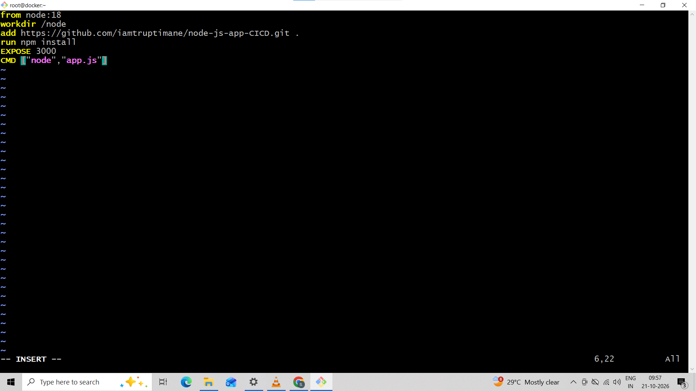
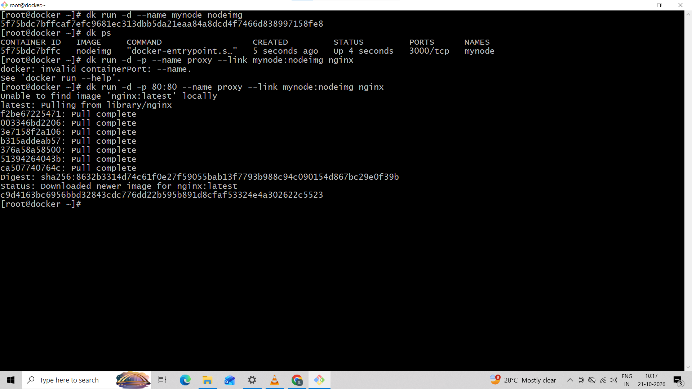
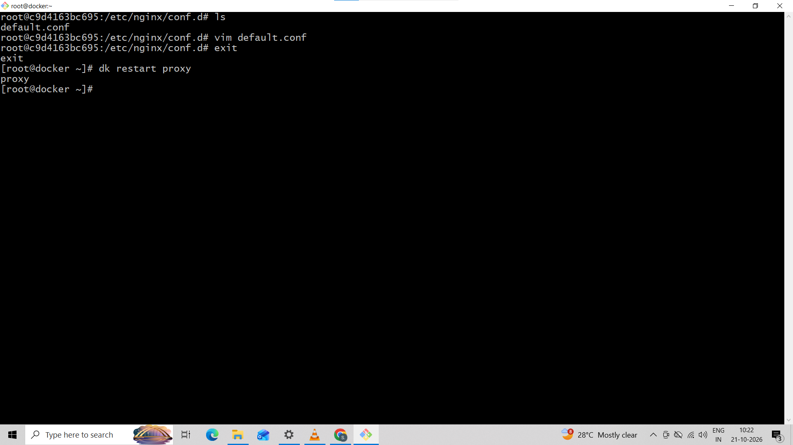
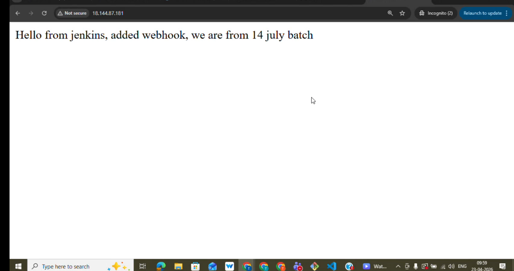

# Node.js Application Deployment Using Docker

## Project Overview

This project demonstrates how to containerize a Node.js application using Docker and a Dockerfile. Docker packages the application and its dependencies into an image, allowing it to run consistently across environments.

## Technologies Used

- Node.js
- Docker
- Dockerfile
- npm
- Git and GitHub

## Architecture

```text
Node.js Source Code
        |
        v
    Dockerfile
        |
        v
    Docker Image
        |
        v
  Docker Container
        |
        v
 Node.js Application
        |
        v
 Browser (Port 3000)
```

## Project Structure

```text
node-docker-app/
├── app.js
├── package.json
├── Dockerfile
├── screenshots/
└── README.md
```

## Prerequisites

Install Node.js, npm, Docker, and Git.

Verify the installations:

```bash
node --version
docker --version
```


## Build the Docker Image

Run this command from the directory containing the Dockerfile:

```bash
docker build -t node-docker-app .
```

Verify the image:

```bash
docker images
```

## Run the Docker Container

```bash
docker run -d --name node-app -p 3000:3000 node-docker-app
```

Check the running container:

```bash
docker ps
```

## Verify the Application

Open your browser and visit:

`http://localhost:3000`

View application logs:

```bash
docker logs node-app
```

## Useful Docker Commands

| Task | Command |
|---|---|
| List containers | `docker ps -a` |
| Stop container | `docker stop node-app` |
| Start container | `docker start node-app` |
| Remove container | `docker rm -f node-app` |
| List images | `docker images` |
| Remove image | `docker rmi node-docker-app` |
| Rebuild image | `docker build -t node-docker-app .` |

## Screenshots


### 1. Project Files



### 2. Docker Image Build



### 3. Running Docker Container



### 4. Application Running in Browser




## Best Practices

- Keep dependencies consistent using `package-lock.json`.
- Never commit passwords, API keys, or `.env` files.
- Use updated and trusted base images.
- Configure appropriate container security and resource limits.

## Learning Outcomes

- Containerizing a Node.js application.
- Writing a Dockerfile.
- Building Docker images.
- Running and managing Docker containers.
- Troubleshooting application and container logs.

## Author

**Sumit Kamble** — Cloud & DevOps

- GitHub: https://github.com/sumitk-Cloud/
- LinkedIn: https://www.linkedin.com/in/sumit-kamble-a6a3b540/
